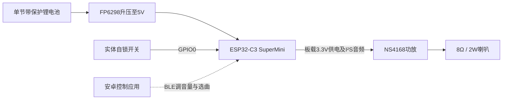

# 可复刻的实体发车铃 · Departure Bell

一台可以自己打板、焊接、烧录的实体发车铃：**按下真实的自锁开关，喇叭循环播放发车音乐；解除自锁后，播放对应的警示音。**

硬件采用 **ESP32-C3 SuperMini + NS4168功放 + 8Ω / 2W喇叭**，由单节锂电池供电。音乐存放在开发板Flash中，设备可独立发声，无需手机持续连接。安卓应用用于通过BLE调音量、选曲和保存设置。

目前已完成实物制作、烧录和试听验证，公开了 **Gerber、BOM、固件源码、可直接烧录的固件包，以及安卓APK和源码**，可以按下面的步骤复刻。PCB生产文件为v6，最新软件版本为v1.1.0，曲库扩充到六首。

**[开始复刻：制作与接线说明](hardware/README.md)** · **[完整下载页](https://github.com/Lc2007081623/departure-bell/releases/latest)**

## 复刻需要的文件

| 文件 | 用途 | 下载 |
| --- | --- | --- |
| Gerber ZIP | 上传PCB厂家制作电路板 | [下载Gerber](https://github.com/Lc2007081623/departure-bell/releases/download/v1.0.0/Gerber_PCB1_2026-10-13.zip) |
| BOM Excel | 按元器件型号、封装和数量采购 | [下载BOM](https://github.com/Lc2007081623/departure-bell/releases/download/v1.0.0/BOM_Board1_PCB1_2026-10-13.xlsx) |
| 固件烧录包 | 包含启动程序、分区表、应用、音频和烧录说明 | [下载固件](https://github.com/Lc2007081623/departure-bell/releases/download/v1.1.0/DepartureBell-firmware-1.1.0.zip) |
| 安卓APK | 连接实体设备，调音量和选曲 | [下载APK](https://github.com/Lc2007081623/departure-bell/releases/download/v1.1.0/DepartureBell-1.1.0.apk) |

**复刻流程：Gerber打板 → 按BOM采购和焊接 → 连接开发板、开关、喇叭、电池 → USB烧录 → 实体按键试听。** 使用发布包可直接烧录，不必先搭建固件和安卓应用的完整编译环境。

## 实体设备结构



## 功能

- 按下自锁开关：随机选择一首音乐并循环播放，也可通过手机指定固定曲目。
- 解除自锁：音乐淡出，播放当前歌曲对应的警示音一次。
- 警示期间再次按下开关：先播完警示，再恢复音乐。
- 警示结束后关闭功放，蓝牙继续保持 **60秒**；期间再次ON立即播放，否则进入深睡。
- 安卓应用可调音量、固定选曲、恢复随机和保存设置；默认75%音量、随机模式。
- 音乐播放时等当前段结束再保存；空闲时立即保存。应用收到成功回复才显示保存完成。

## 安卓应用

[下载 APK](android-app/output/DepartureBell-1.1.0.apk?raw=true)，支持安卓8.0及以上，可覆盖安装1.0.0。也可在本仓库 Releases 下载。六首版需要同时更新设备固件和音频映像。

安装后允许蓝牙权限，保持开关ON，点击“连接发车铃”。先断开nRF Connect等其他控制应用。设备名是 **DepartureBell**。手机与设备之间是BLE控制连接，不传输手机音乐。

[安卓使用与构建说明](android-app/README.md) · [BLE协议及nRF Connect操作](蓝牙控制.md)

## 硬件

- ESP32-C3 SuperMini：板载4MB Flash，板载稳压器输出3.3V。
- NS4168功放：实际供电3.3V，喇叭8Ω / 2W。
- 单节带保护锂电池，FP6298升压到5V，给开发板供电。
- 自锁开关接GPIO0，闭合拉低。外部100k上拉至3.3V、1k串联、100nF消抖。

| GPIO | 功能 |
| --- | --- |
| 0 | 自锁开关，LOW为ON |
| 4 | 功放CTRL |
| 5 | I²S LRCLK |
| 6 | I²S BCLK |
| 7 | I²S SDATA |
| 8 | 板载蓝灯，高电平关闭 |

普通USB连接电脑时，先断开电池供电。此硬件没有USB/电池电源隔离。深睡关闭功放和蓝牙，但升压、板载电源灯和稳压器仍有静态耗电。

## 音频

`bell/`保留原始MP3；文件名括号内数字表示警示开始的秒数。

| 曲目编号 | 文件 | 音乐 / 警示分界 |
| --- | --- | --- |
| 0 | etchujima（24）.mp3 | 24秒 |
| 1 | inage-kaigan（11）.mp3 | 11秒 |
| 2 | JK03-south（18）.mp3 | 18秒 |
| 3 | JT03_SGW（17）.mp3 | 17秒 |
| 4 | JT02_SMB（11）.mp3 | 11秒 |
| 5 | takasaki（17）.mp3 | 17秒 |

音乐与警示共十二段，分别进行两遍响度归一化（目标-20 LUFS、编码前真峰值上限-3dBTP），再转为22050Hz单声道4位IMA ADPCM。播放时解码成16位PCM，通过双声道I²S发送相同样本。首尾和停止转换使用约5ms淡入淡出。每次启动校验音频CRC，失败则禁用播放。

`generated/audio.bin`为可直接烧录的音频映像，`manifest.json`记录分段、偏移和源文件SHA256。`verify_audio.py`检查解码、CRC、分段和响度，实际解码后的十二段约-20.04到-19.88 LUFS。`tracks.json`固定曲目编号；新增歌曲应追加，不能重排旧编号，以兼容NVS保存的设置。`verify_catalog.py`检查固件、安卓和网页的曲目一致性。

## 固件构建与烧录

依赖：Python3.12（audioop）、FFmpeg、Arduino CLI、ESP32 Arduino3.3.10、NimBLE-Arduino2.5.1。Python3.13起移除audioop，本脚本使用3.12。

```powershell
arduino-cli core update-index --additional-urls https://espressif.github.io/arduino-esp32/package_esp32_index.json
arduino-cli core install esp32:esp32@3.3.10 --additional-urls https://espressif.github.io/arduino-esp32/package_esp32_index.json
arduino-cli lib install NimBLE-Arduino@2.5.1
# arduino-cli、ffmpeg和python加入PATH后：
.\build_upload.ps1
.\build_upload.ps1 -Upload -Port COM3
# 也可显式传入工具路径：
.\build_upload.ps1 -ArduinoCli 'C:\tools\arduino-cli.exe' -Esptool 'C:\tools\esptool.exe'
```

烧录需要esptool；脚本可查找PATH或本机Arduino15中的已安装工具。

| 分区 | 偏移 | 大小 |
| --- | --- | --- |
| NVS | 0x9000 | 20KiB |
| 应用 | 0x10000 | 960KiB |
| 音频 | 0x100000 | 3MiB |

无OTA。六首版应用614512字节，音频1375025字节，仍使用原分区。必要时按住BOOT、按RESET、松开BOOT进入下载模式；上传后单独按RESET运行程序。

## 项目结构与验证

| 路径 | 内容 |
| --- | --- |
| `firmware/` | ESP32-C3固件、BLE协议、自定义分区 |
| `android-app/` | 原生Java安卓应用、构建脚本、APK |
| `hardware/` | v6 PCB的Gerber生产文件和BOM（2026-10-13导出） |
| `bell/` | 原始音频 |
| `generated/` | 音频映像、分段与响度数据 |
| `ble_control.html` | 电脑Chrome/Edge用Web Bluetooth控制页 |
| `ble_client.py` | 电脑BLE命令和实物协议测试（依赖bleak） |

1.0.0安卓应用用户反馈使用正常，固件实物检查了音乐循环、对应警示、BLE音量/选曲/随机、保存、再次唤醒连接，以及60秒空闲后的休眠。1.1.0六首版已编译并通过12段音频、曲目编号一致性、安卓协议、APK签名及网页控制检查；已上传实物，通过启动CRC和六首BLE选曲、音量、随机模式检查。新增曲目的试听和手机验证待确认。可运行 `python verify_catalog.py` 和 `node test_ble_control.cjs` 检查六首选曲。

本地签名密钥、完整Flash备份、开发工具及串口日志不纳入仓库。当前为个人DIY项目。

## PCB生产文件

- [Gerber ZIP](hardware/Gerber_PCB1_2026-10-13.zip)：v6 PCB生产文件。
- [BOM Excel](hardware/BOM_Board1_PCB1_2026-10-13.xlsx)：对应元器件清单。

文件按原始导出内容上传，未修改。可编辑EDA工程和原理图尚未纳入仓库。

已提供Gerber生产文件，可据此制作PCB；当前公开资料尚不包含可编辑EDA工程、完整原理图、外壳模型或实物照片。制作时以BOM、板上网络标注和[接线说明](hardware/README.md)为准。

## 许可证

本项目的原创固件代码、安卓应用代码、脚本、文档和硬件设计文件采用 [MIT License](LICENSE)，版权署名为 `2026 Lc2007081623`。

音乐文件 `bell/*.mp3`、由它们生成的 `generated/audio.bin` 以及发布包中的音频内容**不包含在MIT授权内**，其权利归各自权利人所有。第三方库、框架及其编译内容保留各自的许可证；本项目的MIT许可证不替代这些授权。
